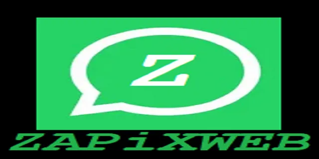

# ZAPiXWEB



     ______         _____ _______   ____          ________ ____     
    |___  /   /\   |  __ \_   _\ \ / /\ \        / /  ____|  _ \      
       / /   /  \  | |__) || |  \ V /  \ \  /\  / /| |__  | |_) |    
      / /   / /\ \ |  ___/ | |   > <    \ \/  \/ / |  __| |  _ <    
     / /__ / ____ \| |    _| |_ / . \    \  /\  /  | |____| |_) |  
    /_____/_/    \_\_|   |_____/_/ \_\    \/  \/   |______|____/ 
	          			      	        ZAPiX Web
W H A T S A P P W E B   E X T R A C T O R						

Author: alberto.magno@gmail.com (https://github.com/kraftdenker)  

LICENSE GNU General Public License v3.0 

Illegal use of this product will be subject to legal proceedings.

Implementation of the technique described in the paper:
Soares, A. (2022). WhatsApp Web Client Live Forensics Technique. In Proceedings of the 8th International Conference on Information Systems Security and Privacy - ICISSP, ISBN 978-989-758-553-1, pages 629-636. DOI: 10.5220/0011006400003120
https://doi.org/10.5220/0011006400003120

ZAPiXWEB WhatsApp Extractor - 4 CHROME, FIREFOX, EDGE, BRAVE. 
->WhatsApp Desktop App (ELECTRON version deprecated by Meta in JUN/2023 - a new technique in development)

Script for WhatsApp Web Client Live Forensics
Script Name: SPIZAPIXWEB.js

Description: A script that extracts through Whatsapp WEB data records.
This live acquisition technique allows automated extraction of messages, attachments,
contacts, and account data from WhatsApp Web sessions opened in web
browsers, even if in a disconnected computer. In line with forensics procedures, the technique extracts digital data that can be loaded into forensic
tools for analysis. 

# Need a WhatsApp DESKTOP forensic extraction tool ?
WhatsApp Desktop Technique - see ZAPiXDESK at https://github.com/kraftdenker/ZAPiXDESK

Some info also in:
https://medium.com/@alberto.magno/whatsapp-desktop-and-web-live-forensics-4n6-233f640e9fb3

# Change Log
-------------
- ChangeLog described into .js source file.
-------------
Using the following module for import into UFED:

	SIMPLEJSON - https://github.com/simplejson/simplejson

# USAGE 
First of all, if online, you must scroll through the conversations of greatest interest "going
up" with the scroll bar until the date of interest. It will download locally the message attachments.
Copy and paste all SPIZAPiXWEB.js code into the browser console + ENTER. 
(For Copy you can execute shell scripts for each specific O.S. that copy code to transfer-area: ZAPiXWEB_WIN.bat,ZAPiXWEB_iOS.sh, ZAPiXWEB_LINUX.sh)

Choose options at webinterface on the left corner of the screen.

In Firefox console, you have to manually type `allow paste` into the console to enable pasting.
In BRAVE, you have to enable File System Access API:
	- Open Brave and type brave://flags in the address bar.
	- Search for “File System Access API”.
	- Enable the flag and restart the browser.

# CONVERSION TO ANDROID WHATSAPP LAYOUT (ZAPiXWEB2WA.py)

The script `ZAPiXWEB2WA.py` converts a ZAPiXWEB `.zip` export (produced by
SPIZAPiXWEB.js in the browser console) into the native Android WhatsApp
directory/database layout, so the result can be handled by Android
forensic tooling:

- `msgstore.db` — Android message database (msgstore.db layout)
- `wa.db`       — Android contacts database (wa.db layout)
- `Media/`      — decrypted media in the modern Android WhatsApp structure
- `raw/`        — the zip's original export files, untouched

## Requirements

- Python 3.8+
- `pycryptodome` (AES/HKDF media decryption):

      pip install pycryptodome

## Usage

```bash
python3 ZAPiXWEB2WA.py ZAPiXWEB_<user>.zip [output_dir]
```

- The integrity file `ZAPiXWEB_<user>.sha512.txt` must sit next to the
  `.zip` (the exact name the browser script writes); the script verifies
  the SHA-512 hash before doing anything.
- If `output_dir` is omitted, it defaults to
  `ZAPiXWEB_<user>_android/` next to the zip file.

## Resulting directory structure

```
ZAPiXWEB_<user>_android/
├── msgstore.db                    # Android message database
├── wa.db                          # Android contacts database
├── Media/
│   ├── WhatsApp Images/           # IMG-*.jpg / .png / .webp
│   ├── WhatsApp Video/            # VID-*.mp4 / .3gp / ...
│   ├── WhatsApp Audio/            # AUD-*.ogg / .mp4 / ...
│   ├── WhatsApp Voice Notes/      # PTT-*.ogg / .opus
│   ├── WhatsApp Animated Gifs/    # GIF-*.gif
│   ├── WhatsApp Documents/        # DOC-*.pdf / .docx / ...
│   └── WhatsApp Stickers/         # sticker-*.webp
└── raw/                           # original ZAPiXWEB export files
    ├── userAccount.json
    ├── contacts.json
    ├── chats.json
    ├── Chat <jid>.json            # one per conversation
    ├── album_metadata_*.json
    └── Attachment ...             # encrypted media as exported
```

# IMPORTING to UFED
Install plugin ZAPiXWEB_UFED_PLUGIN.tplug to UFED and execute choosing project with ZIP containing exported data.
In installation process, "simplejson" directory must be in the same directory of the plugin's file.
Please have a look at ZAPiXWEB_MANUAL.PDF for detailed instructions.

